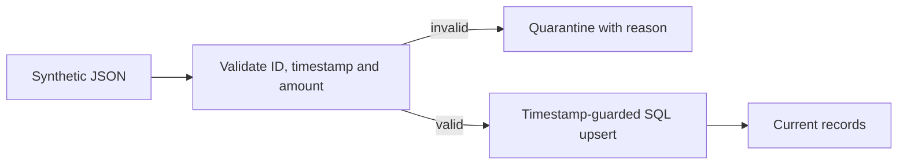

# Abhishek Raj — Data Engineering Portfolio

**Python · SQL · Azure Data Factory · ETL & API Integration**

This repository contains synthetic, independently written learning demonstrations. It does not contain employer code or confidential datasets. New demonstrations are developed with AI assistance and are kept separate from professional experience.

## Runnable work sample

### [Incremental ingestion and validation](work-samples/ingestion-validation)

A dependency-free Python/SQLite example demonstrating validation, quarantine, transactional loading, replay safety and protection against out-of-order updates.

```bash
cd work-samples/ingestion-validation
python -m unittest discover -v
python pipeline.py --input sample.json --database demo.db
python pipeline.py --input sample.json --database demo.db
```

Expected first load: 2 accepted, 1 rejected, 2 stored. Replay: 0 accepted, 1 rejected, 2 stored. Two automated tests passed locally on 12 November 2026.



**Current scope:** local ingestion component. Azure orchestration/deployment and the separate PySpark/Delta demonstration are still in development; they are not represented as completed here.

## Engineering decisions

- Normalize timestamps to UTC before comparison.
- Reject missing/invalid timestamps and non-finite or negative amounts.
- Use a primary key and guarded upsert to make replays harmless and prevent stale updates.
- Commit a batch transactionally; keep invalid payloads and reasons for inspection.
- Equal timestamps are ignored; production conflict resolution requires a source sequence or explicit policy.

## Contact

[GitHub](https://github.com/abhishekraj1305) · [LinkedIn](https://www.linkedin.com/in/abhishekraj1305/)
